  <strong>SHOW UP. STACK STREAKS. EARN ON-CHAIN.</strong> 
  A Solidity-based daily check-in and streak-reward protocol with a wallet-connected contract dashboard.

  
  
  
  
  

  <a href="#-objective">Objective</a> ·
  <a href="#-problem-statement">Problem</a> ·
  <a href="#-solution">Solution</a> ·
  <a href="#-architecture">Architecture</a> ·
  <a href="#-website--dashboard">Website</a> ·
  <a href="#-setup">Setup</a> ·
  <a href="#-security--limitations">Security</a>

---

## ✨ Project overview

**LearnToEarn** is a decentralized habit-incentive prototype. It is designed to reward a participant for checking in on consecutive days. The smart contract stores each wallet's streak, enforces one eligible claim per day, reads a configurable reward schedule and pays rewards from a shared, publicly inspectable native-token pool.

The repository now separates the original **Legacy V1** source from a corrected **V2** implementation. The V2 contract and Foundry tests are provided as source; **V2 has not been deployed**. The website can inspect a deployed contract and only enables claim/fund transactions when a V2 address with bytecode is supplied on the connected wallet network.

## 🎯 Objective

- Encourage consistent daily learning and participation through a simple streak mechanic.
- Make streak state and reward rules verifiable on an EVM-compatible blockchain.
- Keep reward-pool funding and balances transparent to participants.
- Demonstrate wallet-connected smart-contract interaction and test-driven Solidity development.

## ⚠️ Problem statement

Habit and learning platforms often keep participation records in centralized databases. Users may not be able to independently verify how their streak is calculated, whether rewards are funded or which rules determine a payout. A reward system also loses credibility when its logic is unclear or its progress cannot be inspected.

## 💡 Solution

LearnToEarn places the authoritative streak and reward logic in a Solidity smart contract:

1. A participant connects an EVM wallet.
2. The wallet signs a daily check-in transaction.
3. The contract checks the UTC calendar day and updates the streak.
4. The reward for that streak day is read from the contract's schedule.
5. If the pool has enough funds, the contract transfers the configured native-token reward.
6. Events and public state allow the result to be inspected on-chain.

**Rewards are not guaranteed income.** A payout depends on the configured schedule, available pool balance, selected network and successful transaction execution.

## 🧩 Core features

| Feature | Description | Implementation |
|---|---|---|
| Daily check-in | One claim per wallet per UTC calendar day | V2 `login()` |
| Streak progression | Consecutive UTC days increase the streak; a missed day resets it to day one | V2 `lastLoginDay` + `loginStreaks` |
| Configurable rewards | Owner can update a bounded reward schedule | V2 `setStreakBonuses()` |
| Shared reward pool | Anyone can contribute native tokens | V2 `deposit()` |
| Balance transparency | Read the pool's native-token balance | V2 `contractBalance()` |
| Wallet dashboard | Connect an EIP-1193 wallet and inspect contract state | `index.html` + `assets/app.js` |
| Safer payouts | State updates before a checked low-level payment call | V2 `login()` |
| Automated tests | Tests cover consecutive days, missed days, duplicate claims and funding | Foundry |

## 🏛️ Architecture

~~~mermaid
flowchart LR
    U[Participant] --> UI[LearnToEarn Web UI]
    UI --> W[Browser Wallet / EIP-1193]
    W -->|Signs transaction| SC[LearnToEarnV2.sol]
    UI -->|Read calls| SC
    SC --> S[(On-chain streak state)]
    SC --> R[(Reward schedule)]
    SC --> P[(Native-token reward pool)]
    SC --> E[Login / Funding events]
~~~

### Component responsibilities

| Layer | Responsibility |
|---|---|
| Presentation | Responsive landing page, contract inspector, wallet state and reward schedule |
| Wallet | Requests account access and signs user-approved transactions |
| Smart contract | Enforces daily-claim rules, streak transitions and reward payments |
| Reward pool | Holds native tokens used for configured payouts |
| Tests / CI | Validates the contract's expected behavior on a local EVM test environment |

## 🖥️ Website & dashboard

The repository includes a responsive static website at the root.

**Dashboard capabilities**
- Connect an injected EVM wallet such as MetaMask.
- Detect the wallet's current chain ID and check whether bytecode exists at the entered address.
- Read pool balance, the connected wallet's streak and last check-in.
- Read the configured reward schedule.
- Inspect the historical V1 address in read-only mode.
- Interact with V2 after a V2 deployment address is entered and verified on the connected network.

**Run locally**

~~~bash
git clone https://github.com/Adarsh-Singh-Chauhan/-LearnToEarn.project.git
cd ./-LearnToEarn.project
python -m http.server 8000
~~~

Open http://localhost:8000 in a browser with an EVM wallet installed. The website uses ethers.js 6 from a pinned CDN build. A wallet connection and the correct deployed network are needed for live contract reads.

> The repository does not specify the network/chain for the historical V1 address. The dashboard does not guess a chain: choose the correct network in your wallet, then inspect the address. If no bytecode exists, switch networks or verify the address before proceeding.

## 🔎 Contract versions

### Legacy V1 — historical source

- Source: [project.sol](project.sol)
- Address previously listed in this repository: `0xc6BC7A58E304Ac2144afEc045AEfDb67B77713E0`
- Network/chain: **not specified in the repository**
- Dashboard mode: **read-only**; claim and funding controls are disabled.

**Known V1 logic issue:** the `onlyOncePerDay` modifier and the streak-reset branch inside `login()` use the same `> 1 days` condition. If a repeat login passes the modifier, the repeated condition in the function body is also true, so the streak is reset before it is incremented. Successful repeat logins therefore store streak day one rather than accumulating a multi-day streak. The V1 reward schedule then selects its day-one reward on every successful claim. See [Contract Review](docs/CONTRACT-REVIEW.md).

The V1 source comment says the owner deposits funds, but no owner restriction exists: any address can call `deposit()`. The repository's source address has not been independently matched to deployed bytecode in this project update.

### V2 — corrected source, not yet deployed

- Source: [contracts/LearnToEarnV2.sol](contracts/LearnToEarnV2.sol)
- Tests: [test/LearnToEarnV2.t.sol](test/LearnToEarnV2.t.sol)
- Time model: UTC calendar days (not a rolling 24-hour interval).
- Initial bonus schedule: 0, 1, 2, 5, 10 and 20 native-token units at streak indices 0–5.
- Schedule control: only the deploying owner can update it; the contract bounds schedule length and per-claim bonus size.
- Pool funding: any address can deposit; no owner withdrawal function is included.

V2 is source code awaiting review and testnet deployment. Do not treat it as an already deployed or audited contract.

## 🧰 Tech stack & tools

| Area | Technology |
|---|---|
| Smart contract | Solidity `^0.8.24` |
| Contract testing | Foundry / Forge |
| Frontend | HTML5, CSS3, JavaScript |
| Wallet connectivity | EIP-1193 injected wallet provider |
| Web3 library | ethers.js 6 |
| Network | EVM-compatible chain (must be selected in the wallet) |
| Version control | Git + GitHub |
| CI | GitHub Actions |
| Editor/tooling | Any Solidity-compatible editor and terminal |

## 🗂️ Repository structure

~~~text
.
├── assets/
│   ├── app.js
│   ├── favicon.svg
│   ├── learn-to-earn-hero.svg
│   └── styles.css
├── contracts/
│   └── LearnToEarnV2.sol
├── docs/
│   └── CONTRACT-REVIEW.md
├── test/
│   └── LearnToEarnV2.t.sol
├── .github/
│   └── workflows/
│       └── solidity.yml
├── foundry.toml
├── index.html
├── project.sol                 # Historical V1 source
└── README.md
~~~

## ⚙️ Setup

### Prerequisites

- Git
- Foundry (Forge)
- Node-free static hosting or a local web server
- MetaMask or another EIP-1193-compatible wallet for dashboard interaction

### Compile and test V2

~~~bash
# Install Foundry if it is not already installed:
# https://getfoundry.sh/

forge build
forge test -vv
~~~

The GitHub Actions workflow runs the same compile and test commands on relevant pushes and pull requests.

### Deploying V2 (testnet first)

1. Confirm the target EVM chain and obtain its RPC URL.
2. Fund a deployer wallet with that testnet's native test currency.
3. Compile and run the Foundry test suite.
4. Deploy `contracts/LearnToEarnV2.sol` using a secure deployment process.
5. Verify the deployed source on the selected chain's block explorer.
6. Fund the reward pool with test currency.
7. In the website, select **LearnToEarn V2**, paste the V2 address, connect the wallet to the same chain and inspect the bytecode.
8. Rehearse duplicate-day, consecutive-day, missed-day and insufficient-pool cases before any production use.

Never commit private keys, seed phrases or RPC credentials to the repository.

## 🛡️ Security & limitations

- This project is an educational prototype and **has not been externally audited**.
- V1 contains the documented streak-reset bug; its dashboard write controls are deliberately disabled.
- V2 source has not yet been deployed or verified on a public network.
- The target chain for the V1 address is not recorded here.
- Reward payouts depend on pool liquidity and successful transaction execution.
- The V2 owner can update future reward values within the contract's configured bounds.
- The contract uses native currency; no fiat value or financial return is promised.
- The website checks contract bytecode at the address on the wallet's current network. That check does not prove that the bytecode is audited or safe.

Read the full [contract review](docs/CONTRACT-REVIEW.md) before deploying or funding a pool.

## 🗺️ Roadmap

- [x] Inspect and document the V1 streak logic.
- [x] Add corrected V2 Solidity source.
- [x] Add Foundry tests for core streak and pool behavior.
- [x] Build the responsive wallet-connected contract dashboard.
- [x] Add GitHub Actions compile/test workflow.
- [ ] Confirm the target chain and V1 deployment explorer link.
- [ ] Deploy V2 to a testnet and verify its source.
- [ ] Complete independent security review.
- [ ] Configure a public production deployment after testnet validation.

## 🔗 Links

- **GitHub repository:** https://github.com/Adarsh-Singh-Chauhan/-LearnToEarn.project
- **Owner profile:** https://github.com/Adarsh-Singh-Chauhan
- **Legacy V1 address (chain not specified):** `0xc6BC7A58E304Ac2144afEc045AEfDb67B77713E0`
- **V2 source:** [LearnToEarnV2.sol](contracts/LearnToEarnV2.sol)
- **Contract review:** [CONTRACT-REVIEW.md](docs/CONTRACT-REVIEW.md)

---

  <strong>Consistency is a habit. Verification is a feature.</strong> 
  Built by <a href="https://github.com/Adarsh-Singh-Chauhan">Adarsh Singh Chauhan</a>

